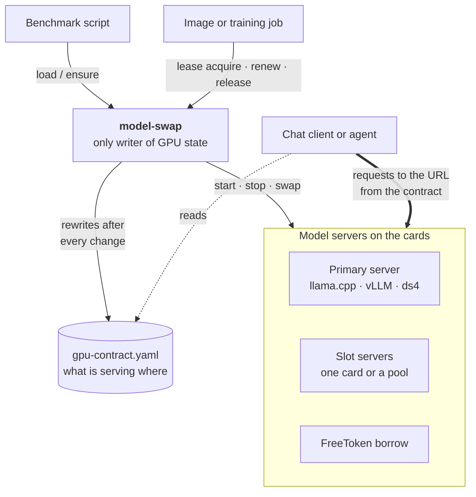
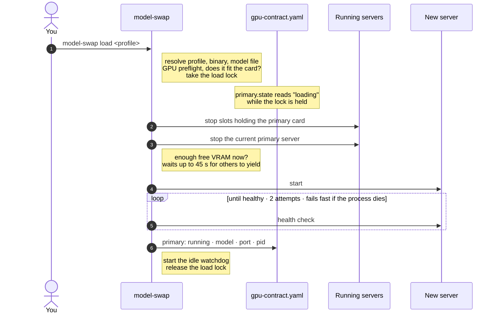
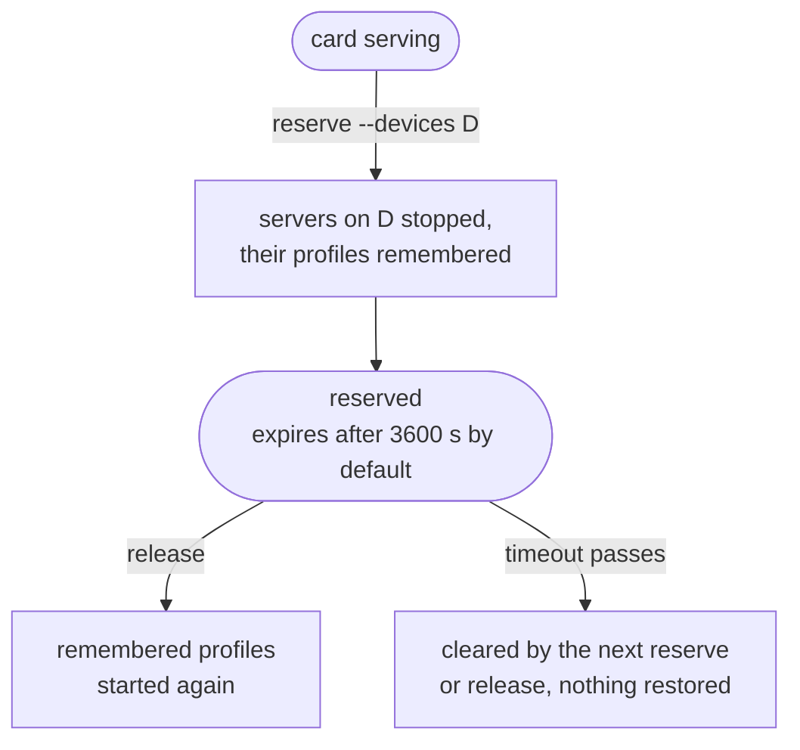
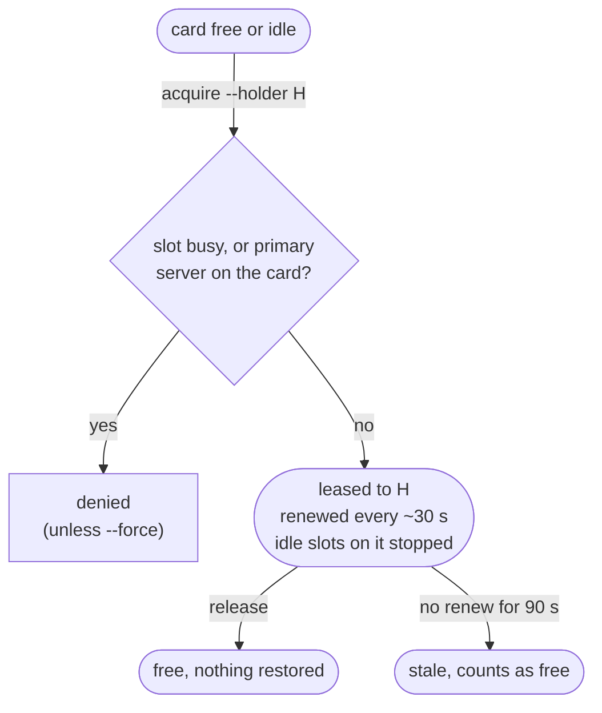

# model-swap

One CLI that owns the GPUs on a local inference box. It starts, stops and
hot-swaps model servers (llama.cpp, vLLM, ds4, FreeToken) on named cards and
card pools, and it is the **only writer** of a small YAML "GPU contract" that
every other program reads to find out what is serving where — so harnesses,
pipelines and scripts never hardcode a port or a card.

Built for multi-GPU machines where several programs compete for the cards
(chat clients, agent harnesses, benchmarks, image generation, training jobs):
model-swap arbitrates with **reservations** (stop servers, hold a card, restore on release)
and **leases** (a renewable, holder-named claim other consumers must respect).

## How it fits together



Programs never start engines or guess ports. They ask model-swap for a change,
then read the contract to find the URL for the model they want.

<p align="center">
  
</p>

## Requirements

- Linux, NVIDIA GPU(s), `nvidia-smi` on PATH
- Python 3.10+ with PyYAML
- At least one engine: `llama-server` from llama.cpp (default backend);
  optionally a vLLM venv, `ds4-server`, or FreeToken's `ft`

## Setup

```
mkdir -p ~/.config/model-swap
cp config.example.yaml ~/.config/model-swap/config.yaml   # or set MODEL_SWAP_CONFIG
nvidia-smi -L                                              # copy your GPU UUIDs into gpus:
./model-swap backends                                      # what each backend needs in a profile
```

The config describes the machine: paths, the primary card and port, extra
**slots** (single cards or pooled cards, each on its own port), device aliases,
and services to report in the contract. It is the only place machine facts
live; the script holds none. Cards are pinned by UUID, so reseating hardware
never moves a model to the wrong card. PCI index and compute capability are
read from `nvidia-smi` at runtime.

Profiles are YAML files in `<models_dir>/profiles/`, one per model + settings:

```yaml
# <models_dir>/profiles/qwen-9b.yaml
model: Qwen-9B-Q4_K_M.gguf        # relative to models_dir, or absolute
vram_required_mb: 9000            # pre-flight gate against capacity and live free VRAM
params: {ctx_size: 32768, n_gpu_layers: 99, flash_attn: "on"}
```

`model-swap backends <name>` prints the full schema for each backend.

## Commands

```
model-swap list                          # profiles, active marker, sizes
model-swap load <profile>                # stop current, start new, health-check, idle watchdog
model-swap ensure [--profile P]          # no-op if healthy, else load: --profile, else last used, else default
model-swap status | gpu | ps             # server, per-card VRAM, processes on each card
model-swap validate [profile]            # model exists + VRAM fits, without starting anything
model-swap slot <slot> ensure|stop|status [--profile P] [--idle-timeout S]
model-swap reserve --devices D --reason R    # exclusive hold; stops servers on D
model-swap release                       # drop the hold, restore what reserve stopped
model-swap lease acquire|renew|release|status --holder H --devices D
model-swap download <hf_repo> [--file F] # rate-limited, resumable GGUF download
```

`--json` on any command gives machine-readable output; `--dry-run` shows what
would happen without touching a card.

### What `load` does



Any failure releases the lock and rewrites the contract, so readers never see
a server that is not really serving. The idle watchdog later stops the server
after `idle_timeout_s` without new tokens; the next `ensure` loads it again.

## The contract

After every state change model-swap atomically rewrites the contract
(default `~/gpu-contract.yaml`): the primary server and every slot (port,
cards, state, model, pid, idle timeout), a flat `models:` map from served model
name to URL, the live reservation and lease, and any `sidecars:` from the config.
Readers only ever read it; they never start engines themselves.

## Sharing the cards: reservations and leases

Two ways for a non-model job to get a card. A **reservation** clears the card
and puts things back afterwards. A **lease** is a claim the holder must keep
renewing, so a crashed holder never blocks a card for long.

**Reservation** (`model-swap reserve` / `release`):



**Lease** (`model-swap lease acquire` / `renew` / `release`):



While a lease is live, model-swap refuses to start any server on the leased
cards, and the idle watchdogs count the lease as activity. A holder that needs
its own model on a leased card sets `MODEL_SWAP_LEASE_HOLDER` so its own
`load` calls are allowed.

## Backends

Each backend has a reference page covering profile fields, how the server is
launched, readiness checks and known gotchas:
[llama.cpp](docs/backends/llama.md) · [vLLM](docs/backends/vllm.md) ·
[ds4](docs/backends/ds4.md) · [FreeToken](docs/backends/freetoken.md).

## Tests

```
python3 tests/leak_guard.py              # no machine facts in tracked files (pre-commit hook)
python3 tests/test_backends_cmd.py       # read-only
python3 tests/test_lease_dry_run.py      # takes a real lease on a non-primary card briefly
python3 tests/test_freetoken_lifecycle.py  # borrows a slot card with a fake `ft`; needs idle slots
python3 tests/topology_snapshot.py       # dump derived config + contract; diff before/after refactors
```

The lifecycle tests run against your real config and contract, so run them on
an idle box. Install the guard as a hook with
`ln -s ../../tests/leak_guard.py .git/hooks/pre-commit`; private words it should
also block go in `~/.config/model-swap/leak-denylist.txt`, outside the repo.

## Status

A single script by design, so it can be copied onto a box and run. Developed
against llama.cpp and vLLM on mixed NVIDIA cards; ds4 and FreeToken support is
newer and less exercised. Issues and pull requests are welcome.

## License

MIT — see [LICENSE](LICENSE).
